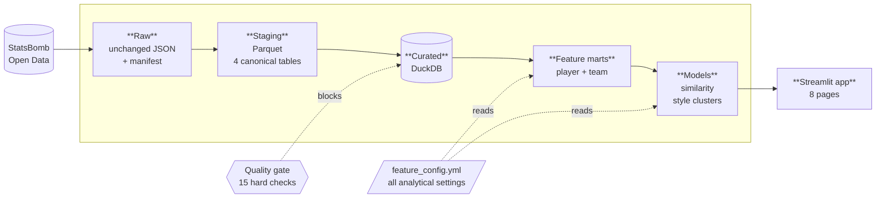
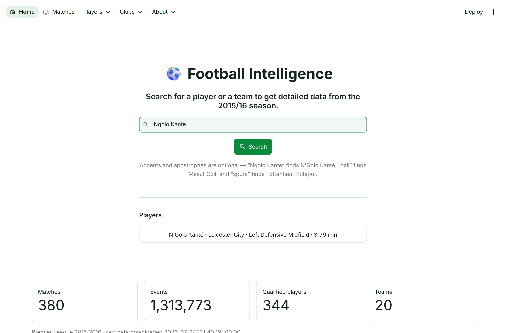
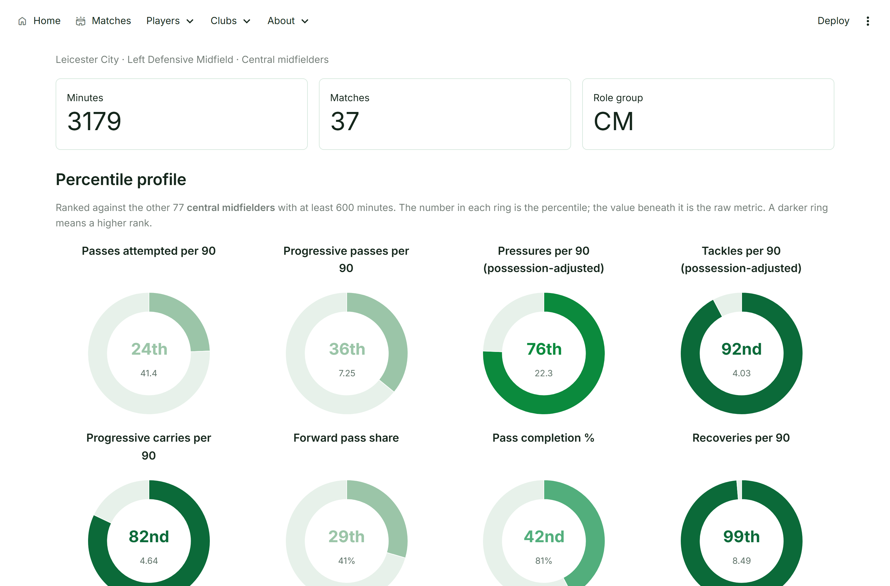
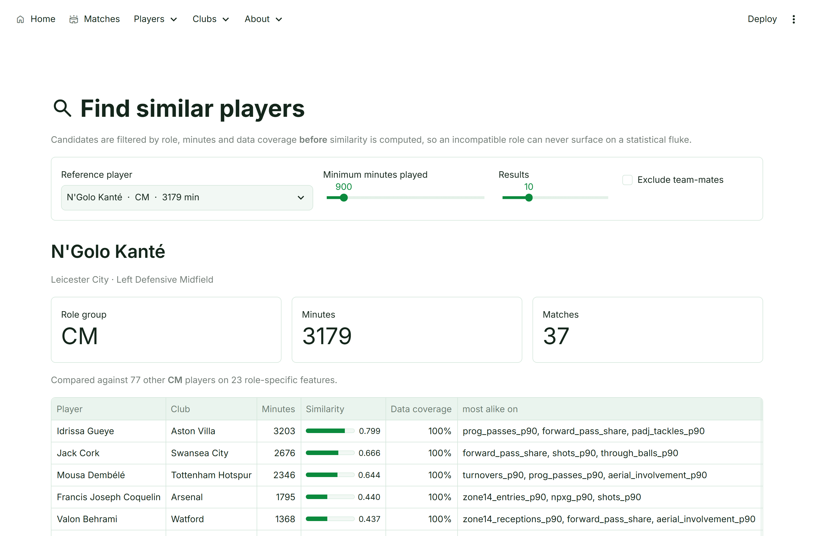
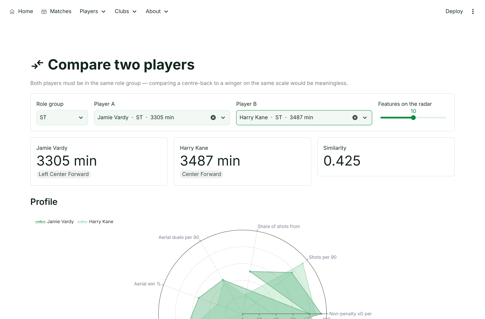
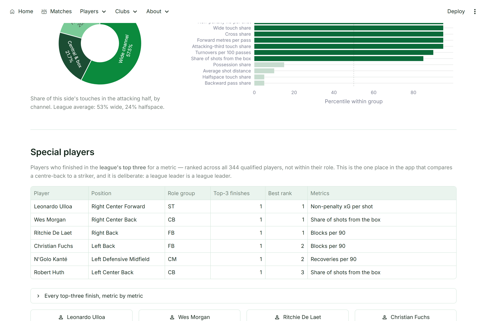
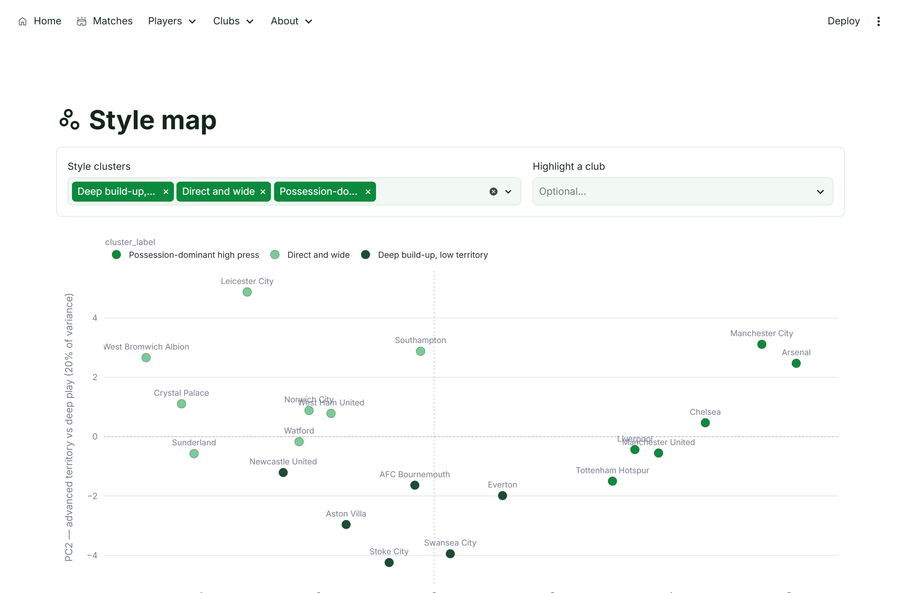
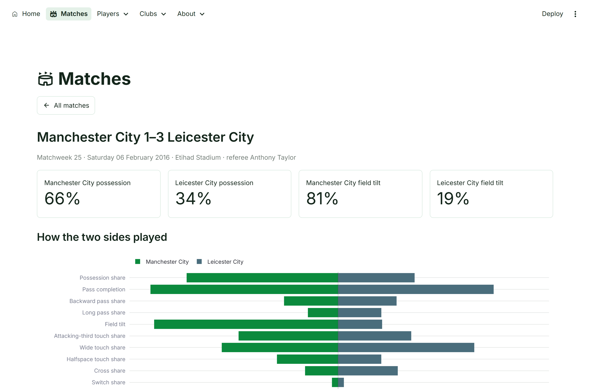

# Football Intelligence Platform

[](https://github.com/SamiRadulov/football-intelligence-platform/actions/workflows/ci.yml)
[](https://www.python.org/downloads/)
[](LICENSE)

Find **stylistically similar players** for recruitment, and group **teams by how they
play** — every result traceable back to the metrics behind it.

Built from **1,313,773 raw match events** (Premier League 2015/16,
[StatsBomb Open Data](https://github.com/statsbomb/open-data)): every pass, carry,
shot, tackle and pressure, each with pitch coordinates.

> **Explicit non-goal:** no match-result, scoreline or betting prediction. Results are
> descriptive. Similarity means two players *do similar things* — not that they are
> equally good, tactically interchangeable, or worth the same fee.

## What it does

| Module | Question it answers |
|---|---|
| **Player Recruitment Similarity** | Who resembles this player, filtered by role and minutes — and *why*, dimension by dimension |
| **Team Playing-Style Classification** | Which teams play alike, grouped into data-driven style clusters with evidence-based labels |

It works. Searching for **N'Golo Kanté** returns Idrissa Gueye (0.80), Jack Cork and
Mousa Dembélé — the other ball-winning midfielders. Searching for **Mesut Özil**
returns Kevin De Bruyne (0.85), David Silva and Dimitri Payet. The team clusters
describe Leicester's title season as direct, wide and shot-efficient with minimal
possession, having been told nothing about them.

Around those two modules the app is a browsable reference for the season: a
profile for every qualified player, a page per club with its record and its
league-leading players, and a report for each of the 380 matches. One search box
reaches all of it, and it takes names as they are typed — `Ngolo Kante` finds
N'Golo Kanté, `ozil` finds Mesut Özil, `spurs` finds Tottenham Hotspur.

## Architecture



Each layer only reads from the one above and never edits it, so every number in the
app can be traced back to the event it came from. The build **fails** if any hard
quality check breaks, so the marts can never be built from data that violates them.

**Stack:** Python 3.12 · pandas · DuckDB + Parquet · scikit-learn · Plotly ·
Streamlit · pytest + Ruff + GitHub Actions.

## Quick start

```bash
# 1. Create the environment (Python 3.12+)
py -3.12 -m venv .venv
.venv\Scripts\python -m pip install -e ".[dev]"

# 2. Download the raw StatsBomb layer for the configured dataset (PL 2015/16).
#    ~1.2 GB into data\raw\ (gitignored). Use --limit N for a quick sample.
.venv\Scripts\python scripts\download_data.py

# 3. Build the canonical staging layer (Parquet + DuckDB) and run quality checks.
.venv\Scripts\python scripts\build_staging.py

# 4. Build the player feature marts (role-aware per-90 / percentile metrics).
.venv\Scripts\python scripts\build_player_features.py

# 5. Build the team style marts (per-match features, season mean + variability).
.venv\Scripts\python scripts\build_team_features.py

# 6. Fit the team style clusters (use --explore first to review k and centroids).
.venv\Scripts\python scripts\build_team_clusters.py

# 7. Query the similarity engine.
.venv\Scripts\python scripts\find_similar.py "Kante" --top 5

# 8. Launch the app (opens at http://localhost:8501).
.venv\Scripts\streamlit run app.py

# 9. Run the tests and the similarity validation.
.venv\Scripts\python -m pytest -q
.venv\Scripts\python scripts\validate_similarity.py
```

On macOS or Linux use `.venv/bin/python` instead of `.venv\Scripts\python`.

## Data layers

| Layer | Location | Contents |
|---|---|---|
| Raw | `data/raw/` (gitignored) | Unchanged StatsBomb JSON + `manifest.json` |
| Staging | `data/staging/` (gitignored) | Canonical Parquet: `dim_matches`, `dim_players`, `fact_lineups`, `fact_events` |
| Curated | `data/curated.duckdb` (gitignored) | Canonical tables **and** feature marts in DuckDB, queried by the app |

**Feature marts** (built on the curated layer):

| Mart | Grain | Contents |
|---|---|---|
| `mart_player_match` | player-match | Raw metric counts |
| `mart_player_season` | player | Role-aware per-90, possession-adjusted and percentile features (≥ 600 minutes) |
| `mart_team_match` | team-match | 28 playing-style features |
| `mart_team_season` | team | Season mean, match-to-match standard deviation and league percentile |
| `model_team_style` | team | PCA coordinates, style cluster + label, distance to centroid, nearest teams |

Build steps read raw and write staging/curated; nothing overwrites raw. See
[docs/METRIC_DICTIONARY.md](docs/METRIC_DICTIONARY.md) for metric definitions.

The dataset is defined once in [artifacts/feature_config.yml](artifacts/feature_config.yml); every step reads it from there.

## Data source & attribution

This project uses **StatsBomb Open Data**. See [DATA_SOURCES.md](DATA_SOURCES.md) for attribution and licensing details. Raw data is not redistributed in this repository.

## The app

```bash
.venv\Scripts\streamlit run app.py
```

### Home

One search box over players, clubs and fixtures. Queries are matched on an
accent- and punctuation-stripped form of the name, then *ranked* rather than
merely filtered, so a surname, an informal club name or a typo all still land on
the right page.



### Player profile

Twelve percentile rings — the features weighted most heavily for that player's
role, so the profile shows what the similarity model actually looks at rather
than a separate set of metrics chosen to flatter. Every percentile is **within
the role group**; the full feature table sits underneath.



### Find similar players

Pick a reference player, filter candidates by minutes, and get a ranked list — each
row carrying its similarity score, the share of features actually available for that
player, and the dimensions the two players are most and least alike on.



### Compare two players



### Club profile

Two halves that answer different questions. The record — final position, home and
away splits, biggest win, heaviest defeat — comes from results and needs no model.
The style fingerprint, nearest neighbours and match-to-match variability come from
the 28-feature marts and say nothing about quality. A **special players** table
lists everyone at the club who finished in the league's top three for a metric,
ranked across all 344 qualified players rather than within their role.



### Style map

The two strongest style dimensions found in the data, coloured by cluster. The axes
were not chosen in advance: PC1 turned out to separate control from directness, PC2
advanced territory from deep play. Leicester's title-winning season sits well outside
everyone else.



### Matches

All 380 fixtures, and a report for each: the result, both sides' 28 style features
mirrored against one another, and every named player's match totals.



All eight pages: **Home**, **Matches**, **Find similar players**, **Player
profile**, **Compare two players**, **Club profile**, **Style map**, and
**Methodology & data quality** (metric definitions, validation results, pipeline
checks and limitations).

Screenshots are generated by `scripts/capture_screenshots.py` rather than taken by
hand, so they stay current when the UI changes. Colours and the type scale come
from `.streamlit/config.toml`, not from CSS injected at runtime.

## Methodology

[METHODOLOGY.md](METHODOLOGY.md) documents the modelling choices, validation results
and limitations. In short: features are standardized within role group, similarity is
weighted cosine on those z-scores, candidates are filtered *before* scoring, and every
result is explained by decomposing the weighted feature distance.

## License

Code is licensed under the [MIT License](LICENSE). Data is governed by the StatsBomb Open Data user agreement.
